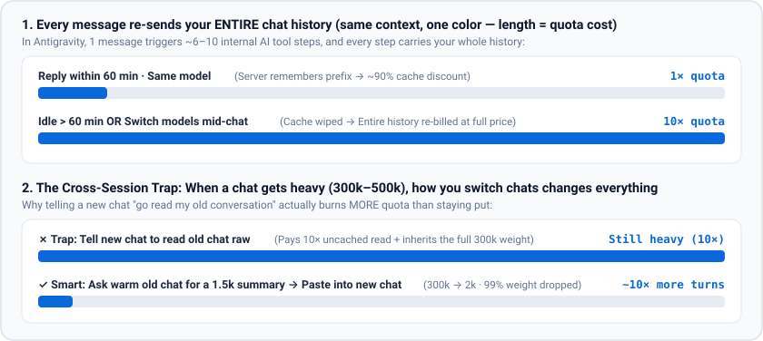
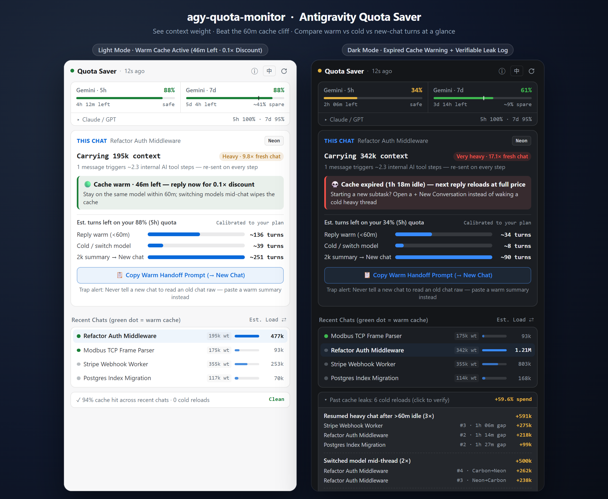

# agy-quota-monitor

**[简体中文](./README.zh-CN.md)** | **English**

> **Quick note:** If you only want to check your remaining quota %, Antigravity's built-in model picker at the bottom already shows it. This project exists for one practical goal: **stretching your existing quota without upgrading your plan** — by making hidden conversation weight, the 60-minute cache cliff, and remaining turns visible in plain English right next to your chat.

---

## First: How Quota Actually Gets Burned (30-Second Visual Guide)

Even before installing anything, knowing these two rules will immediately save half your 5-hour quota:



1. **You don't send 10 words — you re-send your entire chat history × ~8 tool steps**
   When you type *"fix the button color"* in a long thread, Antigravity sends all **300k–500k tokens** of prior chat + file reads. Worse, 1 message triggers **~6–10 internal AI tool calls** on average — carrying that 300k backpack on *every single step*.
2. **The 60-minute cliff & mid-chat model switching (`1×` vs `10×`)**
   - Reply **within 60 minutes on the same model**: the server still holds your prefix in prompt cache (~90% off, **`0.1×`**).
   - Pause **over 60 minutes** or **switch models mid-thread** (e.g. `Neon ↔ Carbon`): cache drops to `0%`, and your entire history is re-billed at **`1.0×` full price** (a 10× jump on that step).
3. **Why "New chat, go read my old chat" is a hidden trap**
   Opening a fresh chat and telling it to *read your old conversation log* forces an uncached **10× full-price read** of the entire old thread — and immediately makes the new chat just as heavy as the old one.
   **The right way:** while the old chat's cache is still warm (`<60m`), ask it for a **1,500-word handoff summary**, then paste *only* that summary into a new chat (`300k → 2k`).

---

## What the Side Panel Shows You Live


<details>
<summary>View Expiring Cache Alert vs Expired Cold-Reload State (Light &amp; Dark Themes)</summary>



</details>

No long reports to read — just three live signals for the chat in front of you:

- **Current Backpack Weight** — e.g. `Carrying 316k context (Heavy · 16× fresh chat)`, plus your average AI tool steps per message so you *feel* how heavy each reply is.
- **Live 60-Minute Cache Countdown + Other-Chat Alerts** — ticks down in real time (`🟢 46m left` → `⚠️ Expires in 8m 40s!` → `💀 Cache expired`), and warns you if *another* heavy background chat is about to hit 60 minutes.
- **Estimated Turns Left on Your 5h Quota** — auto-calibrates against your own observed `5h %` drops and compares three single-color bars:
  - **Reply warm (`<60m`)** vs **Cold / switch model** vs **2k summary → New chat**, plus a 1-click **`📋 Copy Warm Handoff Prompt`** button.
- **Verifiable Past Leaks (Collapsed Into 1 Line)** — tucked quietly at the bottom; click anytime to verify exact past turns, minute gaps, and model switches from local `transcript.jsonl` logs.

---

## One-Prompt Install (Let Your AI Set It Up)

Paste this single prompt into **Antigravity** (or any local coding agent) and let it install both the official `agy` CLI (if needed) and the plugin automatically:

```text
Read https://raw.githubusercontent.com/boheastill/agy-quota-monitor/main/setup/SKILL.md and automatically install and configure the agy-quota-monitor plugin on my machine.
```

Once installed, click **`+` → Quota** at the top-right of any conversation (toggle **`EN` / `中`** anytime in the panel header).

---

## Manual Installation

### 1. Official `agy` CLI (Optional — for top `5h / 7d` cloud `%` bars)

> Context weight, 60m cache countdowns, and relative turn savings work offline even without the CLI. Installing `agy` unlocks live `5h / 7d` remaining `%` and exact remaining-turn calibration.

```powershell
# Windows (PowerShell)
winget install --id Google.AntigravityCLI --accept-source-agreements --accept-package-agreements
```
```bash
# macOS / Linux
curl -fsSL https://antigravity.google/cli/install.sh | sh
```

### 2. Install the Plugin

```powershell
# Windows PowerShell
git clone https://github.com/boheastill/agy-quota-monitor.git
cd agy-quota-monitor
.\scripts\install.ps1
```

```bash
# macOS / Linux
git clone https://github.com/boheastill/agy-quota-monitor.git
cd agy-quota-monitor
chmod +x scripts/install.sh && ./scripts/install.sh
```

---

## Safe & Zero-Overhead by Design

- **100% official & read-only**: Reads cloud `%` via official `agy -p "/usage" --output-format json` (**0 LLM tokens used**) and session metrics from local `transcript.jsonl` files.
- **Zero `npm` dependencies**: Pure Node.js built-ins + Antigravity's native `sidecar_sdk`. No private RPC scraping, no chat-blocking hooks, and zero background polling when the side panel is closed.
- **Standalone Web Preview / JSON API**: Run `node scripts/dev-server.mjs --port 4790` to inspect in any browser or consume `GET /api/status` in custom `agy acp` workflows.

## License

[MIT](./LICENSE)

---

Built by **[Bohea Still](https://boheastill.com/?r=gh-agy-quota)** — independent engineer building industrial automation, protocol gateways, and pragmatic AI developer tools.
