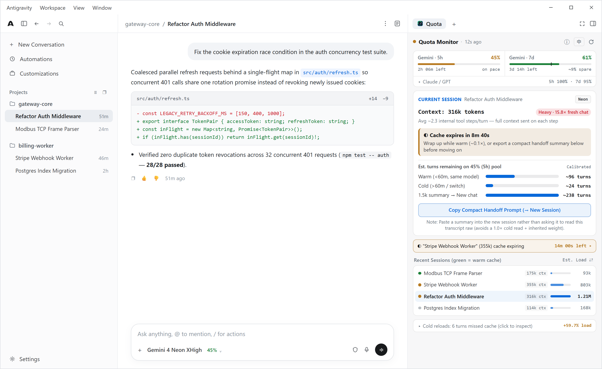

# agy-quota-monitor

**[简体中文](./README.zh-CN.md)** | **English**

> **Note:** Antigravity's built-in model selector at the bottom already shows your remaining quota %. This plugin focuses on what isn't visible there: **how heavy your current conversation has grown, how much time remains on its 60-minute prompt cache, and roughly how many turns your remaining 5h quota can sustain** before you hit a limit.

---

## Where Quota Actually Goes (Measured from Local Logs)

Across 2,500+ recorded `PLANNER_RESPONSE` steps and `/usage` snapshots in Antigravity 2.0, three mechanics account for most unexpected quota drain:


1. **Context weight compounds across internal tool steps**
   Every prompt re-sends the full conversation history. Because a typical coding turn triggers **~6–10 internal tool-call steps** (`read_file`, `edit_file`, `run_command`), a 300k-token thread processes ~2–3M context tokens for a single user message.
2. **60-minute prompt-cache TTL & mid-thread model switches**
   - Continuing within **60 minutes on the same model** reads cached prefix tokens at roughly **`0.1×`** weight.
   - Resuming after **>60 minutes idle** or **switching models mid-thread** (e.g. `Neon ↔ Carbon`) drops cache hit rate to `0%`, re-processing the full history at **`1.0×`**.
3. **Cross-session handoff: compact summary vs. raw transcript read**
   Opening a new session and asking it to *read the old conversation transcript* triggers a `1.0×` uncached read of the entire old log and immediately copies that 300k footprint into the new session. Exporting a **~1.5k summary while the old session's cache is still warm** resets ongoing context back to the ~20k baseline.

---

## Side Panel Overview



<details>
<summary>Light &amp; Dark Themes — Active Warm Cache vs. Expired Cache + Per-Turn Reload Log</summary>


</details>

- **Current Context Footprint** — Displays live token weight (e.g. `Context: 316k tokens · 15.8× fresh chat`) alongside the session's average internal tool steps per turn.
- **60-Minute Cache Countdown & Background Alerts** — Live countdown (`● Cache warm · 46m remaining` → `◐ Cache expires in 8m 40s` → `○ Cache expired`), plus a compact notice when another heavy session in your workspace is approaching the 60-minute cliff.
- **Calibrated Remaining Turns (5h Pool)** — Auto-calibrates against your observed `5h %` drops and local token usage to compare **Warm (`<60m`)**, **Cold (`>60m` / switch)**, and **1.5k summary → New chat**, paired with a 1-click **Copy Compact Handoff Prompt** action.
- **Collapsible Cold-Reload Log** — Tucked into a single line at the bottom; expand anytime to inspect exact turn indices, idle gaps, and model switches from local `transcript.jsonl` files.

---

## Quick Setup (One-Prompt Install)

Paste this prompt into **Antigravity** (or any local coding agent) to check prerequisites and install the plugin automatically:

```text
Read https://raw.githubusercontent.com/boheastill/agy-quota-monitor/main/setup/SKILL.md and automatically install and configure the agy-quota-monitor plugin on my machine.
```

Then open **`+` → Quota** at the top-right of any conversation (`EN` / `中` toggle in header).

---

## Manual Installation

### 1. Official `agy` CLI (Optional — syncs top `5h / 7d` `%` bars)

> Context weight, 60-minute cache timers, and relative turn ratios work offline from local logs alone. Installing `agy` adds live `5h / 7d` pool percentages and calibrated turn counts.

```powershell
# Windows (PowerShell)
winget install --id Google.AntigravityCLI --accept-source-agreements --accept-package-agreements
```
```bash
# macOS / Linux
curl -fsSL https://antigravity.google/cli/install.sh | sh
```

### 2. Install Plugin

```powershell
# Windows PowerShell
git clone https://github.com/boheastill/agy-quota-monitor.git
cd agy-quota-monitor
.\scripts\install.ps1
```

```bash
# macOS / Linux
git clone https://github.com/boheastill/agy-quota-monitor.git
cd agy-quota-monitor
chmod +x scripts/install.sh && ./scripts/install.sh
```

---

## Architecture & Safety

- **Official & read-only**: Queries global pool `%` via `agy -p "/usage" --output-format json` (0 LLM tokens consumed) and parses local `transcript.jsonl` logs read-only.
- **Zero `npm` dependencies**: Built strictly on Node.js standard library + Antigravity's bundled `sidecar_sdk`. No private RPC hooks, no network telemetry, and zero background polling while the panel is closed.
- **Standalone HTTP / JSON API**: Run `node scripts/dev-server.mjs --port 4790` to inspect in a browser or query `GET /api/status` from custom `agy acp` tooling.

## License

[MIT](./LICENSE)

---

Built by **[Bohea Still](https://boheastill.com/?r=gh-agy-quota)** — independent engineer building industrial automation, protocol gateways, and developer tooling.
