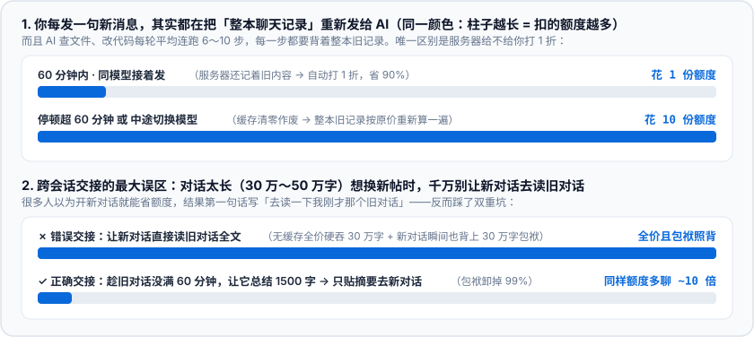
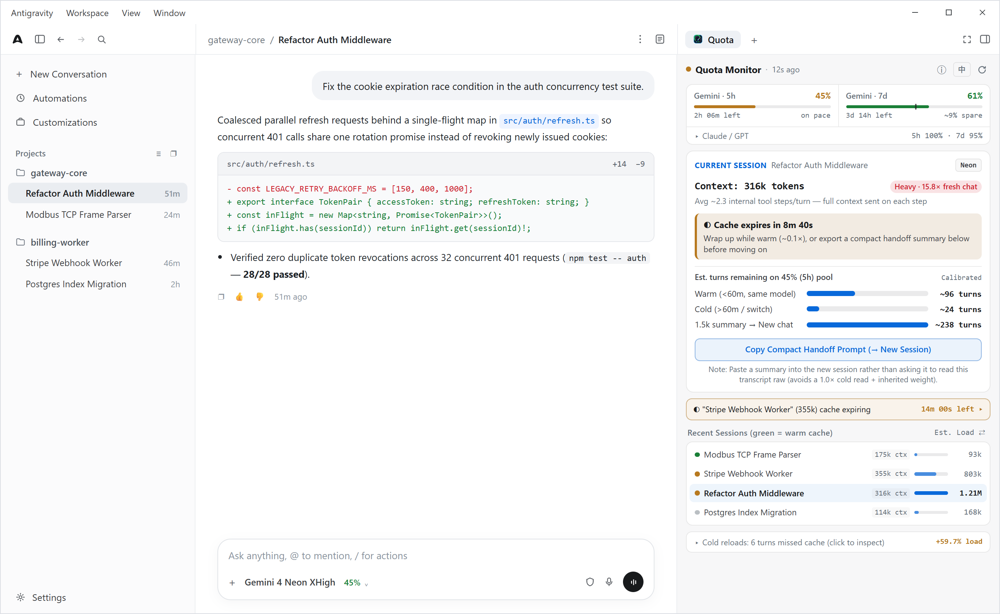
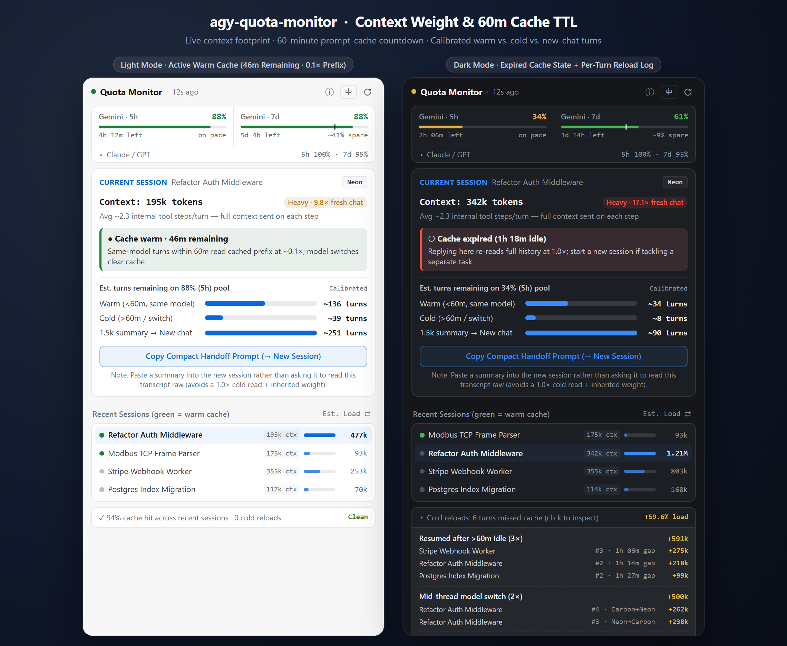

# agy-quota-monitor

**简体中文** | **[English](./README.md)**

> **说明：** Antigravity 底部模型选择器本身已支持查看剩余配额百分比。本插件主要补充底部看不到的三项工程指标：**当前会话累积的上下文体积、60 分钟前缀缓存剩余有效时间，以及当前剩余 5h 配额在不同续聊方式下预计还能支撑多少轮**，方便在不升级套餐的前提下合理控制消耗。

---

## 配额主要消耗在哪里？（基于本地日志实测）

结合本机 2,500+ 步 `PLANNER_RESPONSE` 日志与 `/usage` 采样对账，配额快速下降通常来自以下三个机制：



1. **上下文体积 × 内部工具步数的乘数效应**
   每次发送消息，系统都会携带完整历史记录。由于一次常规编码指令平均会触发 **6～10 步内部工具调用**（读文件、改代码、跑测试），在一个累积到 300k token 的长会话中，发一句话实际会处理约 200 万～300 万上下文 token。
2. **60 分钟前缀缓存有效期与中途切换模型**
   - **60 分钟内同模型续聊**：历史前缀命中服务端缓存，约按 **`0.1×`** 权重计费；
   - **闲置超过 60 分钟**，或在长会话**中途切换模型**（如 `Neon ↔ Carbon`）：缓存命中率归零，整段历史按 **`1.0×`** 未缓存原价重新处理。
3. **跨会话迁移：导出摘要 vs. 直接读取旧会话记录**
   新建会话后如果让 AI *“直接去读取旧会话原始记录”*，第一步会触发对旧记录的 `1.0×` 全量未缓存读取，且新会话会立即继承相同的几十万上下文体积。更经济的做法是：**趁旧会话仍在 60 分钟缓存有效期内导出约 1.5k 字的结构化摘要，仅将摘要粘贴到新会话**，使后续每步上下文回到 ~20k 基线。

---

## 右侧面板功能概览



<details>
<summary>亮/暗主题对比 —— 缓存有效态 vs. 缓存到期态与逐轮重读明细</summary>



</details>

- **当前上下文体积**：实时显示当前会话携带的上下文大小（如 `当前上下文 316k · 极重 · 新会话的 15.8×`）及单轮平均工具调用步数。
- **60 分钟缓存倒计时与后台到期提醒**：实时显示缓存剩余时间（`● 缓存有效` → `◐ 即将到期` → `○ 已到期`）；若工作区内其他大体积会话即将满 60 分钟，会单行提示以便及时收尾。
- **自动校准的剩余可用轮数（5h 池）**：结合本机观测到的 `5h` 百分比降幅与本地 Token 记录自动校准兑换比例，用单色比例条直观对比 **趁缓存续聊**、**超时/切模型重读** 与 **1.5k 摘要 → 新会话**，并提供一键复制交接摘要提示词按钮。
- **底部单行可折叠对账**：历史未命中缓存的轮次默认收起在底部一行，需要复盘时点开即可查看具体会话、轮次编号与间隔时长。

---

## 快速安装（单条提示词自动配置）

将以下指令发给 **Antigravity**（或任意本地编程 Agent），即可自动检查环境并完成安装：

```text
请读取 https://raw.githubusercontent.com/boheastill/agy-quota-monitor/main/setup/SKILL.md 并按步骤帮我在本机自动安装好这个额度面板插件
```

安装后点击任意会话右上角 **`+` → Quota** 打开面板（右上角支持 **`中` / `EN`** 切换）。

---

## 手动安装

### 1. 官方 `agy` CLI（可选，用于同步顶部 `5h / 7d` 百分比）

> 上下文体积、60 分钟缓存倒计时与相对轮数比例仅靠本地日志即可离线运行；安装 `agy` 后可同步云端配额百分比并校准预计剩余轮数。

```powershell
# Windows (PowerShell)
winget install --id Google.AntigravityCLI --accept-source-agreements --accept-package-agreements
```
```bash
# macOS / Linux
curl -fsSL https://antigravity.google/cli/install.sh | sh
```

### 2. 安装插件

```powershell
# Windows PowerShell
git clone https://github.com/boheastill/agy-quota-monitor.git
cd agy-quota-monitor
.\scripts\install.ps1
```

```bash
# macOS / Linux
git clone https://github.com/boheastill/agy-quota-monitor.git
cd agy-quota-monitor
chmod +x scripts/install.sh && ./scripts/install.sh
```

---

## 架构与安全边界

- **官方通道、纯只读**：全局配额通过官方 `agy -p "/usage" --output-format json` 读取（不消耗模型 Token），会话指标只读解析本地 `transcript.jsonl`。
- **零第三方 `npm` 依赖**：仅使用 Node.js 标准库与 Antigravity 内置 `sidecar_sdk`，不逆向私有接口、不挂载对话拦截钩子；关闭面板时后台零轮询。
- **独立网页与 JSON 接口**：运行 `node scripts/dev-server.mjs --port 4790` 可在浏览器独立查看或通过 `/api/status` 接入自定义 `agy acp` 工具。

## 开源协议

[MIT](./LICENSE)

---

由 **[Bohea Still](https://boheastill.com/zh/?r=gh-agy-quota)** 独立开发维护 —— 专注工业自动化通信、边缘网关与开发者工程工具。
